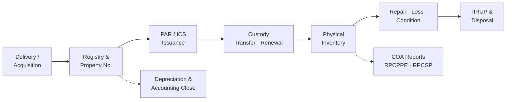

# UPLB Asset Management Portal (AMP): What It Does and How It Helps the SPMO

**Prepared:** 5 November 2026
**Branch reviewed:** `feat/revamp-amp`
**Audience:** SPMO leadership, university administrators, and partner offices (Accounting, Internal Audit, COA)

---

## 1. Summary

The **UPLB Asset Management Portal (AMP)** is the university's online system for
government property. It follows each item through its whole life: the delivery is
recorded, the item gets a property number, it is issued to an accountable officer,
transferred, counted, repaired, reported lost, or disposed of.

For the **Supply and Property Management Office (SPMO)**, AMP replaces separate
spreadsheets, typed COA forms, and paper routing with **one shared record**. Every
AO, end user, and partner office works from that same record.

The main effects on the SPMO's daily work:

| Area | Before (manual) | With AMP |
|------|-----------------|----------|
| Property numbers and PAR/ICS numbers | Assigned by hand from logbooks, so duplicates and gaps happen | Generated automatically, in sequence, with no collisions |
| COA forms (PAR, ICS, PTR, IIRUP, RPCPPE, RPCSP, WMR, RLSDDP) | Typed in Word or Excel and re-encoded for each form | Produced as PDFs from data that is already in the system |
| "Who has this item?" | Searching folders and asking the offices | A live custody record per item and per person |
| Physical inventory | Paper count sheets, then encoding, then reconciliation | Campaign count sheets that produce the COA reports directly |
| Chasing missing documents | Calls, emails, and follow-up visits | Automatic reminders and web push to the responsible office |
| Year-end and audit reports | Weeks of consolidating office files | Generated on demand from the report centre |

---

## 2. Who Uses AMP

| User | Panel | What they do |
|------|-------|--------------|
| **SPMO staff and admins** | Admin panel (`/admin`) | Approve acquisitions, manage numbering, issue and transfer property, run inventory, process disposals, produce COA reports |
| **Administrative Officers (AOs)** | App panel (`/app`) | Register their office's deliveries, upload supporting documents, generate PAR/ICS, track their office's items |
| **Accountable officers and end users** | App panel / mobile (pilot) | See the items under their name, confirm the items they still hold, respond to transfers |
| **Accounting** | Admin reports | Depreciation schedules, accounting close pack, reconciliation working papers |
| **COA / Internal Audit** | Reports and PDFs | RPCPPE, RPCSP, IIRUP, Found at Station, Non-Existing/Missing reports |
| **Anyone holding a printed PAR/ICS** | Public QR page (`/verify/{code}`) | Checks that the printed document is genuine |

**Access is restricted by office.** An AO sees only their own office's records
(plus records they created for a project in another office). SPMO and super
admins see everything. Sign-in uses the **UP Portal (SSO)** or UP Mail, so there
are no separate passwords to manage.

---

## 3. What AMP Does: The Property Lifecycle

### 3.1 Acquisition and Registration (Intake)

- AOs **register delivered items** with article, UACS code, unit cost, supplier,
  fund source, serials, and location on a map. Batches with many items can be
  entered in one step.
- A **UACS code picker** with built-in search and classification keeps
  items under the correct account.
- Each acquisition moves through **DRAFT → PENDING → APPROVED**:
  - Generating the PAR/ICS creates a **DRAFT**.
  - The acquisition moves to **PENDING** by itself once every required document
    (IAR, photos, and so on) is uploaded.
  - **SPMO approves** it, and the official numbers are assigned at that point.
- **Property numbers and PAR/ICS numbers** are generated by the database in the
  COA format. One ICS number covers one acquisition and is renumbered cleanly at
  approval.
- **Document-upload reminders:** SPMO can flag a stalled DRAFT. The AO then gets
  a web push notification and an in-app pop-up. The reminder clears itself once
  the documents are uploaded.

### 3.2 Issuance and Custody (Accountability)

- Items at or above the **capitalization threshold** get a **PAR**. Items below
  it get an **ICS**. The threshold is set once in Accounting Settings.
- Every item has a **custody record**: who holds it, since when, and under which
  document.
- **Property Transfer Report (PTR):** a transfer is recorded as pending, then
  approved. Custody moves only after approval, and a numbered COA PTR is
  produced.
- **PAR renewal:** AMP tracks the COA 3-year renewal and flags PARs that are due
  or overdue. A renewal keeps the same PAR number with a new version.
- **Cross-office projects:** when an AO in one office registers items for a
  project leader in another office, the right signatories can still be selected,
  and both offices keep visibility.
- **Custody boards:** SPMO gets a ledger of all custodies. End users get a
  "people board" showing what they hold.

### 3.3 Physical Inventory (Annual Count)

- SPMO opens an **inventory campaign**. Offices fill in the count sheet in the
  portal.
- The counts produce the COA reports directly:
  - **RPCPPE** (property, plant and equipment)
  - **RPCSP** (semi-expendable property)
  - **Inventory Count Form (ICF)**, for equipment and motor vehicles
  - **Found at Station** and **Non-Existing / Missing PPE**

### 3.4 Condition, Loss, and Repair

- **Pre-repair and post-repair inspections** are recorded with findings.
- **Report of Loss** covers theft, destruction, or loss, with relief and
  "found" outcomes (RLSDDP).
- An **insurance register** and **committees** (inspection, disposal) are kept
  in the same system.

### 3.5 Disposal

- Unserviceable items are listed on an **IIRUP**, then go to pending disposal and
  then to approval. Only an approved disposal removes an item from the books.
- The **Waste Materials Report (WMR)** controls destruction and sale.
- Disposal depends on the item's **condition**, not its age. A fully depreciated
  item stays accountable until it is properly disposed of.

### 3.6 Depreciation and Accounting

- **Depreciation engine:** straight-line, using useful-life tables per article.
  Only PPE depreciates. ICS items do not, in line with GAM.
- A **depreciation report** and an **accounting close pack** give Accounting the
  working papers it needs to reconcile with eNGAS.

### 3.7 Data Foundations (Behind the Scenes)

| Capability | What it gives the SPMO |
|------------|------------------------|
| **HR data feed (Kafka)** | Employees, offices, and appointments arrive from HR, so nobody re-types personnel lists |
| **Registry import staging** | Legacy spreadsheets are uploaded, matched to employees and articles, reviewed, and only then committed. No more blind bulk imports |
| **Old Assets migration desk** | Legacy PPE is brought into the system. End users confirm the items they actually hold |
| **UACS chart** | One maintained chart of accounts, with depreciation rules per class |
| **Audit trail** | Who changed what, and when, on every record |
| **Unread markers** | New or changed records show as unread, so nothing slips past a reviewer |
| **Dashboards** | Asset distribution by UACS, PAR/ICS totals per office, a map of item whereabouts |
| **Guided tutorials** | In-app walkthroughs for first-time AOs |

---

## 4. A Day in the SPMO: Before and After

| SPMO task | Manual process | With AMP | What the SPMO gains |
|-----------|----------------|----------|---------------------|
| Receive a new acquisition | Paper IAR and PO arrive. Staff encode them into a spreadsheet and assign a number from a logbook | The AO has already registered the items and uploaded the documents. SPMO reviews and approves | Encoding moves to the office that has the information. SPMO only checks and approves |
| Prepare PAR/ICS | Type the form, compute totals, look up signatories, print | One click generates the PDF with signatories filled in | Fewer typing errors and much faster turnaround |
| Answer "where is item X?" | Search binders and call the office | Search by property number, serial, or person | Instant answer, with history |
| Follow up incomplete documents | Phone calls and memos | Flag the acquisition, and the reminder is pushed to the AO | Follow-up is tracked and closes itself when done |
| Process a transfer | Paper PTR routed for signatures, then the ledger is updated by hand | PTR created in the system. Custody moves on approval | The ledger and the paper always match |
| Annual physical inventory | Distribute paper sheets, collect, encode, reconcile, type the RPCPPE | Open a campaign, offices count, reports generate | Weeks of consolidation drop to report generation |
| Monitor PAR renewals | Usually not tracked | Due and overdue list | Meets the COA 3-year requirement |
| Prepare for a COA audit | Consolidate office spreadsheets and reconcile differences | Pull RPCPPE, RPCSP, IIRUP, and Missing/Found reports | Audit-ready at any time, not just at year end |
| Year-end closing with Accounting | Separate depreciation computations, frequent mismatches | Depreciation schedule and close pack from the same data | One source of figures for both offices |

---

## 5. Impact

### 5.1 Operational Efficiency
- **Less re-encoding.** Data is entered once, at the source office, and reused
  in every form and report.
- **Workload is shared.** AOs register and document their own deliveries, so
  SPMO moves from data entry to review and control.
- **Faster turnaround.** PAR, ICS, PTR, and the COA reports are generated rather
  than prepared by hand.

### 5.2 Accountability and Control
- **Every item has a named holder** and a full custody history.
- **Numbering cannot collide or be skipped**, because the database generates it
  in sequence.
- **Office-level access:** offices see only their own property, and SPMO sees
  all of it.
- **Audit trail and QR verification** discourage tampering with records and
  printed documents.

### 5.3 COA and GAM Compliance
- The COA appendices (PAR, ICS, PTR, IIRUP, RPCPPE, RPCSP, WMR, RLSDDP, ICF) come
  from one consistent dataset.
- The rules are built into the system: the PAR/ICS threshold, 3-year PAR renewal,
  disposal by condition, and no depreciation on ICS items.
- Lower risk of **audit observations** caused by unreconciled or missing records.

### 5.4 Financial Reporting
- Depreciation and asset values come from the same registry, which makes
  **SPMO and Accounting reconciliation** easier.
- The accounting close pack supports eNGAS posting. Posting itself stays in
  eNGAS.

### 5.5 Decision-Making
- Dashboards show **asset distribution by UACS and by office**, and where items
  are located.
- Management can see **idle, missing, unserviceable, or due-for-disposal**
  property, which helps with redistribution and budget planning.

---

## 6. Current Status and Rollout

| Module | Status |
|--------|--------|
| Acquisition, Registry, numbering, PAR/ICS, documents, reminders | **Live** |
| Item Custody, PTR, PAR renewal, cross-office projects | **Live** |
| Depreciation engine, UACS chart, Portal SSO, public QR verification | **Live** |
| Registry import staging, Old Assets migration desk | **Live and being refined** |
| COA/GAM module: disposal, physical inventory, loss, WMR, repair inspection, insurance, committees, management and close reports | **Built; testers only** (`coa_gam` feature flag) |
| Mobile app (Flutter): scan-to-count, attest "I still have this", PTR on the go | **Pilot; testers only** (`mobile_app` feature flag) |

Gated modules are released to everyone by switching one setting, without a new
deployment. That allows SPMO to pilot with selected offices first.

---

## 7. Measuring the Impact (Suggested KPIs)

These targets are proposed. Baselines should be taken before the full rollout.

| KPI | How to measure | Direction |
|-----|----------------|-----------|
| Days from delivery to approved PAR/ICS | Acquisition `created_at` to approval date | ↓ |
| Acquisitions stuck in DRAFT more than 30 days | Count from the acquisition ledger | ↓ |
| Share of PPE with a named accountable officer | Custody records ÷ registry items | ↑ (target 100%) |
| Share of PARs past their renewal date | PAR renewal overdue list | ↓ |
| Physical inventory cycle time | Campaign open date to final RPCPPE | ↓ |
| Variance between count and books (missing or found items) | Missing and Found at Station reports | ↓ |
| COA audit observations on property | Annual Audit Report | ↓ |
| Old assets confirmed by end users | Old Assets review status | ↑ |

---

## 8. Risks and Dependencies

| Risk or dependency | Mitigation |
|--------------------|------------|
| **Data quality of legacy records** (old spreadsheets, unmatched names) | Import staging with a review step, the Old Assets confirmation flow, and employee name matching |
| **Office adoption:** AOs must encode and upload documents | Guided tours, upload reminders, and SSO for easy sign-in |
| **HR data feed** availability | Staging plus "Seed from Kafka". Personnel can still be maintained by hand if needed |
| **Network access** to the UP Portal for SSO | UP Mail and password sign-in as fallback |
| **Field work without Wi-Fi** (inventory counts) | The mobile app is designed to work offline |
| **Production setup** (Redis cache, S3 storage, push notification keys) | Follow the deployment checklist (`integration-checklist.md`) |

---

## 9. Next Steps

1. **Pilot the COA/GAM module** with SPMO and two or three volunteer offices.
   Run one physical inventory campaign end to end.
2. **Finish migrating old assets.** Have end users confirm their legacy PPE so
   the registry is complete.
3. **Record KPI baselines** (Section 7) before the full release.
4. **Release the COA/GAM module** to all offices by switching the feature flag.
5. **Pilot the mobile app** for the next annual count and PAR attestation.
6. **Brief COA and Accounting** on the generated reports so they are accepted as
   official working papers.

---

*AMP stays the SPMO's property and accountability system. Procurement (PR, BAC,
PhilGEPS) and eNGAS journal posting are outside its scope. AMP produces the
records those processes reconcile against.*
